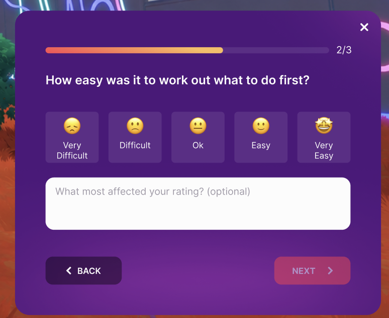
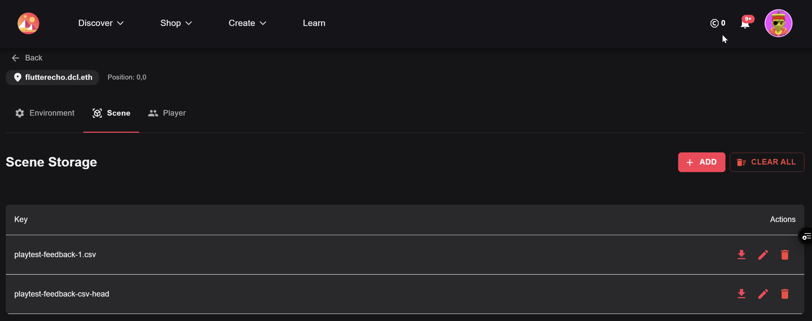
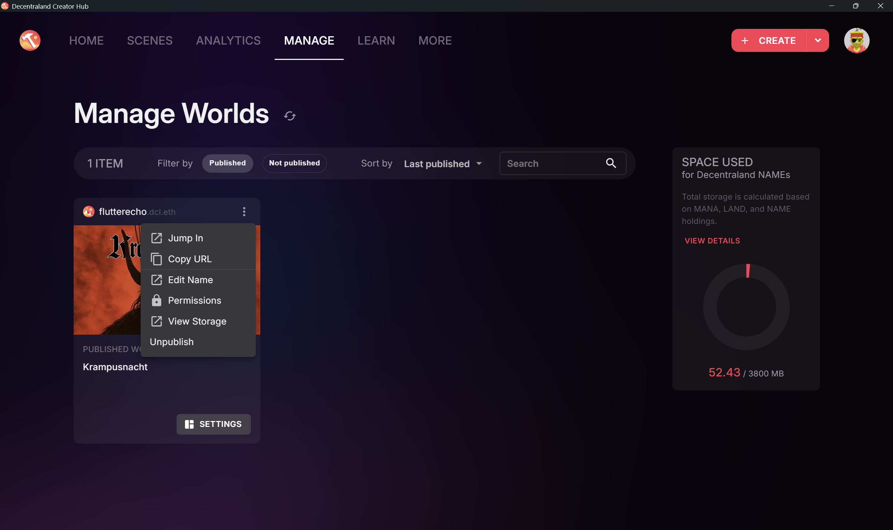

# Scene Feedback

Asks players a Question with a labelled 1–5 rating and an optional comment, or a text-only
Question, at moments the creator picks.

<p align="center">
  <a href="assets/images/feedback-panel.png">
    
  </a>
  <br>
  <em>Figure 1. Feedback during play.</em>
</p>

The Multiplayer Server saves responses to CSV files in scene Storage, ready to download in one click.

<p align="center">
  <a href="assets/images/scene-storage.png">
    
  </a>
  <br>
  <em>Figure 2. Download responses from Scene Storage. This screenshot shows the older file names; new files use scene-feedback-N.csv.</em>
</p>

This scene contains the feedback library and a small coin-hunt example ([src/game.tsx](src/game.tsx)) that asks Questions
mid-round, after a round, and as a two-Question series. Its [questions.ts](src/scene-feedback/questions.ts)
demonstrates bank questions, custom rating scales, and a text-only Question.

Start with [four steps to your first response](#add-it-to-your-scene), or give your
[AI agent the installation prompt](#install-with-an-ai-agent).
For a specific integration, choose a recipe in [EXAMPLES.md](EXAMPLES.md).

## Add it to your scene

### 1. Install

- **Copy the files:**

  - [src/scene-feedback/](src/scene-feedback) into your scene's `src/`.
  - [assets/scene-feedback/](assets/scene-feedback) into your scene's `assets/`.

- **Enable the server** so the module can save responses:

  - Use `@dcl/sdk@auth-server`.
  - Set `"authoritativeMultiplayer": true` in `scene.json`.

  See the [Multiplayer Server setup](https://docs.decentraland.org/creator/scenes-sdk7/networking/authoritative-servers) for more details.

- **Allow fetch:** add `"USE_FETCH"` to `requiredPermissions` in `scene.json`, keeping any existing permissions.

### 2. Configure

Configure [questions.ts](src/scene-feedback/questions.ts):

- **Set `INTRO`** with your greeting and invitation to give feedback.
- **Edit `QUESTIONS`:** use bank questions or adapt them to your scene.
- **Choose a `scale` for rating questions:** pick a built-in scale or create your own five
  labels following the example below. For a text answer, use a [text-only question](#comments-and-text-only-questions).

```ts
export const INTRO: IntroSpec | null = {
  title: "Hi, we're the Coin Hunt team!",
  text: "We're testing a new experience and would love to hear what you think."
}

export const QUESTIONS = {
  playMore: QUESTION_BANK.motivation.playMore,
  buyingUpgrade: {
    text: 'How easy or difficult was it to buy an upgrade?',
    scale: 'EASE',
    commentPrompt: 'What most affected your rating? (optional)' // omit for rating only
  },
  nextCoinKnown: {
    text: 'How often did you know where the next coin was?',
    scale: ['Never', 'Rarely', 'Sometimes', 'Often', 'Always'] // your own five labels
  }
} satisfies Record<string, QuestionSpec>
```

For choosing and adapting questions, see the [question guide](QUESTION_GUIDE.md).

### 3. Ask

Import `feedback` on both client and server startup paths; it starts automatically.
Connect calls like these to your scene's client-side events:

```ts
import { feedback } from './scene-feedback'

// After a purchase: ask permission, then one question.
function onFirstPurchaseUiClosed() {
  void feedback.intro('first-purchase')
  void feedback.ask('buyingUpgrade', 'first-purchase')
}

// Later, after a round: ask a group, one question at a time.
function onRoundUiClosed() {
  void feedback.ask(['buyingUpgrade', 'playMore'], 'round-complete')
}
```

The first event requests consent; later questions use that choice for the rest of the visit.
For an earlier intro or a player-opened form, see the [integration examples](EXAMPLES.md).

### 4. Review

Test your integration locally, then deploy to your World and submit a response there.
In Creator Hub, open **Manage → your World's ⋮ menu → View Storage**.

<p align="center">
  <a href="assets/images/creator-hub-view-storage.png">
    
  </a>
  <br>
  <em>Figure 3. Open your World's Storage from Creator Hub.</em>
</p>

This opens a browser page with **Scene Storage** (see Fig. 2), where you can browse and download
the CSV files (e.g. `scene-feedback-1.csv`).

Use the `questionId` and `trigger` columns to find your test response.
Check that its answer matches what you submitted.
See [CSV fields](#csv-fields), [missing recent responses](#a-recent-response-is-missing),
and [reading the results](QUESTION_GUIDE.md#reading-the-csv).

## Install with an AI agent

Give your coding agent this installation prompt:

```text
Add the Scene Feedback module to this Decentraland SDK7 scene.

Installation and API:
https://github.com/decentraland/sdk7-test-scenes/blob/main/scenes/0,-1-scene-feedback/README.md

1. Inspect the scene's UI, events, and client/server startup. Clarify any
   unspecified playtest goal, intro timing, and question timing with me.
2. Install using the README, preserving the scene's settings and functionality.
   For event wiring, follow its EXAMPLES.md link and select a matching recipe.
   Prefer Scene Feedback's API and configuration; change src/scene-feedback/lib/
   when the intended behavior needs an extension, explaining the gap.
3. For choosing and adapting questions, follow QUESTION_GUIDE.md. Configure a
   small set tied to the playtest goal and the scene's specific actions and objects.
4. Run the relevant available checks. Report the configured triggers, checks
   passed, remaining tests, and how to verify the CSV in the deployed World.
```

## API reference

Choose the behavior you need:

- [Offer ratings, comments, or text answers](#comments-and-text-only-questions).
- [Ask during play](#asking-participants-during-play-dynamic-approach).
- [Let players open a form](#asking-participants-through-a-feedback-form-static-approach).

For return values and panel behavior, see [Queue and results](#queue-and-results)
and [Group navigation and skipping](#group-navigation-and-skipping).

### Keep game logic on the client

Keep the `feedback` import on both client and server startup paths.
If your scene has no server-side game logic, start `main()` with
`if (isServer()) return`, as in the [demo](src/index.ts).
For scenes with server logic, guard only the player-facing code.
The feedback panel uses its own UI renderer alongside your scene's UI.

### Comments and text-only questions

In `questions.ts`:

- **Rating only:** provide `scale` and omit `commentPrompt`.
- **Rating with a comment:** add `commentPrompt`.
- **Text only:** set `commentOnly: true`, add `commentPrompt`, and omit `scale`:

```ts
anythingWrong: {
  text: 'Was there anything annoying, unusual, or wrong during the round?',
  commentOnly: true,
  commentPrompt: 'What happened, and what were you trying to do?'
}
```

To hide optional comments for a particular call, use `comment`:

```ts
// Rating only for this call.
void feedback.ask('playMore', 'mid-round', { comment: false })

// Only playMore offers an optional comment.
void feedback.ask(['buyingUpgrade', 'playMore'], 'round-complete', { comment: ['playMore'] })
```

Text-only answer fields always remain visible.
See the [mixed-group example](EXAMPLES.md#5-a-mixed-group-after-the-first-game).

### Asking participants during play (dynamic approach)

Set `ASK_PARTICIPANTS_ONLY` in `questions.ts` to choose who receives questions from `ask()`:

- **`true` (default):** only enrolled participants receive questions.
- **`false`:** everyone receives questions except players who declined the Intro during this visit.

There are two ways to enroll a participant for the current visit:

1. **`feedback.intro(trigger)`** — invite the player to participate. Accepting enrolls them;
   declining opts them out. Call it before the first `ask()`; queued questions wait for the answer.
   You can also show the Intro earlier and ask questions at a later event:
   [separate-intro example](EXAMPLES.md#1-intro-now-question-after-play).
2. **`feedback.enroll(trigger)`** — enroll a player directly, for example a tester selected by
   wallet ID. Call it once their player identity is available
   ([see example](EXAMPLES.md#4-selected-testers-without-an-intro)).

Use `feedback.participation()` to read `in`, `out`, or `unknown`.
To react to the Intro's result, await `feedback.intro(trigger)`:
it returns `accepted`, `declined`, or `not-shown`.

With the default setting, `ask()` returns `not-shown` if consent is missing and no Intro
is pending. It does not open an Intro or replay missed events later.
Setting `INTRO = null` disables the Intro; use enrollment if participation is required.

The table below summarizes who receives questions under each setting:

| `ASK_PARTICIPANTS_ONLY` | Accepted or enrolled (`in`) | Not yet enrolled (`unknown`) | Declined (`out`) |
|---|---|---|---|
| `true` (default) | Questions shown | Consent or enrollment required | Questions not shown |
| `false` | Questions shown | Questions shown | Questions not shown |

### Asking participants through a feedback form (static approach)

Use `leaveFeedback()` to ask a series of questions when the player chooses to give feedback.
Invite them through a button, kiosk, or area trigger. With `INTRO` configured, the form
shows a greeting before the questions; with `INTRO = null`, it opens the questions directly.

```ts
// When the player selects Leave feedback.
void feedback.leaveFeedback(['buyingUpgrade', 'playMore'], 'feedback-button')
```

- Choose questions the player can answer whenever they open the form.
- Players can reopen it, including after declining game-triggered questions.
- Its greeting does not change participation in game-triggered questions.
- Calls while this form is already open or waiting are ignored.

Use the [player-opened form recipe](EXAMPLES.md#3-feedback-opened-by-the-player)
or the demo's [button, kiosk, and area handlers](src/leave-feedback.tsx).

## Question bank

- [src/scene-feedback/lib/bank.ts](src/scene-feedback/lib/bank.ts) contains 20 selected Questions,
  grouped into `coreMechanic`, `coreLoop`, `social`, `motivation`, `world`, and `technical`.
  Each includes a rating scale, suggested timing, what the answer can tell you, and a reference
  code in [QUESTION_BANK.md](QUESTION_BANK.md).
- [src/scene-feedback/lib/shared/scales.ts](src/scene-feedback/lib/shared/scales.ts) contains
  14 rating scales. Choose one that fits your question, or use these examples to create your own with five labels.
- [QUESTION_BANK.md](QUESTION_BANK.md) contains a larger collection of 113 candidate questions
  for inspiration, with [suggested sets by playtest goal](QUESTION_BANK.md#ready-made-sets).
- [QUESTION_GUIDE.md](QUESTION_GUIDE.md) helps you choose and adapt questions, decide
  when to ask them, and interpret the answers.

## Debug

- **Preview the mobile layout:** set `PREVIEW_MOBILE = true` in `questions.ts` and
  resize the Explorer window to a phone-like aspect ratio (e.g. 1600 × 720).
  This setting applies only to local previews.
- **Try the debug UI:** the example scene enables it with `DEBUG = true`.
  It is available in local previews and, when deployed, to the World's owner and deployers.
  Feel free to adapt it to your needs; set `DEBUG = false` before release.

## Stored CSV

The authoritative Multiplayer Server saves feedback responses in your scene's Storage as
`scene-feedback-1.csv`, `scene-feedback-2.csv`, and so on. The module limits each CSV file to
400 KB; when the next batch would exceed that limit, it writes the new responses to the next file.

`scene-feedback-csv-head` stores the number of the file currently being written.
This is an internal bookkeeping key: **do not delete or modify it**.

Storage allows up to 512 KB per value and 10 MB per World, shared by all its scenes.

```csv
id,timeUtc,version,questionId,questionText,trigger,rating,ratingLabel,scale,commentPrompt,comment,secondsInScene,playersInScene,address,isGuest,platform
mfqz8k2x4f7a9c,2026-09-30 12:27:33,x7q2mdk4ea,playMore,How interested are you in playing more right now?,debug,5,Extremely,INTEREST,"What makes you want to keep playing, or stop? (optional)",kind of yes,42,1,0x…,true,desktop
```

### CSV fields

Each row contains these fields, in order:

**Identify the response and its question**

- `id`: response identifier used to deduplicate retries.
- `timeUtc`: when the server received the response, in UTC.
- `version`: tail of the deployed entity ID; `preview` during local testing.
- `questionId`: question key from `QUESTIONS`, or `intro` for participation responses.
- `questionText`: question wording from the deployed configuration; the Intro title for `intro` rows.
- `trigger`: event label supplied to the API call; `debug` for debug-button responses.

**Read the answer**

- `rating`: selected value from 1 to 5, or empty when no rating was given.
- `ratingLabel`: selected label, or a response status such as `skipped` or `accepted`.
- `scale`: built-in scale code or custom labels joined with ` | `; empty for text-only questions.
- `commentPrompt`: text field prompt shown to the player; empty if the field was not offered.
- `comment`: submitted text, or empty.

**Place the answer in context**

- `secondsInScene`: time from scene load to the answer, reported by the client.
- `playersInScene`: number of players present when the server received the response.
- `address`: the responding player's address, in lowercase.
- `isGuest`: `true` or `false`; empty if guest status was unavailable.
- `platform`: platform reported by the client.

### How to read the responses

- **Separate test data:** filter out `trigger = debug` before reviewing playtest answers.
- **Read ratings with their labels:** use `ratingLabel` and `scale` to interpret the number.
- **Recognize skipped questions:** `ratingLabel = skipped` with empty `rating` and `comment`
  means the player skipped, closed, or advanced without answering.
- **Recognize text answers:** a nonempty `comment` with empty `rating` and `ratingLabel`
  means the player answered only with text. Text-only questions also have an empty `scale`.
- **Distinguish missing from unoffered comments:** an empty `commentPrompt` means no text
  field was offered; a nonempty prompt with an empty `comment` means it was left blank.
- **Read participation separately:** `questionId = intro` uses `ratingLabel` values
  `accepted`, `declined`, or `enrolled`. To calculate opt-in, use
  accepted ÷ (accepted + declined) for game Intro triggers, separately from player-opened forms.

For comparing answers and drawing conclusions, see
[Reading the CSV](QUESTION_GUIDE.md#reading-the-csv).

### A recent response is missing

Allow up to a minute for the server to write it, then refresh Scene Storage and download
the latest CSV part. Look for the `questionId` and `trigger` used in your test.
For data-loss and submission limits, see [Storage behavior and limits](#storage-behavior-and-limits).

## Details

### Storage behavior and limits

- Text fields are flattened to one line. A leading `= + - @` is prefixed with `'`
  to prevent spreadsheet formulas from running.
- The server acknowledges responses when buffered, before writing to Storage. A crash or
  redeploy can lose up to a minute of responses; acknowledged rows are not resent.
- Storage has no compare-and-set: overlapping server instances after a redeploy can
  overwrite each other's rows.
- One address can submit at most 100 rows per 10 minutes; further responses are dropped.
- The server buffers at most 2000 rows. Beyond that it stops acknowledging responses;
  the client retries every 3 seconds for up to 30 seconds.

### Updating the module

To update to a newer version, replace `src/scene-feedback/lib/` and `assets/scene-feedback/` with the new
ones; `questions.ts` stays yours.

### Queue and results

**When a question opens.** `ask()` waits until no other feedback panel is on screen and the
server is up (~15 s on a cold start). Participation must allow the question; see
[enrollment rules](#asking-participants-during-play-dynamic-approach).

**When to ask again.** An ID is shown once per trigger per visit. Pass `{ repeat: true }`
to allow it again. Closing a Group also marks its unreached questions as handled at that trigger.

**What the call returns.** A single question returns one result; a Group returns one per
requested ID, in the same order:

| Result | Meaning |
|---|---|
| `submitted` | A rating or nonblank comment was kept for submission. |
| `skipped` | The question was reached and left unanswered, skipped, or closed without a kept answer. |
| `not-shown` | The question was not reached: participation blocked it, it was already handled at this trigger, the server wait exceeded 2 minutes, or the Group closed before it. |

These results describe the player's response, not confirmation of a Storage write.
Question IDs are checked by TypeScript.

### Group navigation and skipping

| Player action | Result |
|---|---|
| **Next** or **Back** | Keep the draft on the client and move to the adjacent question. |
| **Submit** on the last question | Send the Group's responses and close it. An unanswered question counts as skipped. |
| **Skip** on the first question, or **×** | Close the Group and send responses for reached questions using the rules below. |

When the Group closes with **Skip** or **×**:

- Answers kept while navigating are sent.
- The question on screen counts as skipped if the player has not previously left it.
  If they returned to it using Back or Next, its current answer is used.
- Unreached questions produce no CSV row and are not asked again at the same trigger.

An entirely unanswered Group closes without a thank-you message. On an answered last
question, "Completed" replaces the progress bar; the player still presses **Submit** to send.

## How to test this scene

1. Run `npm install`, then `npm start` from this scene's folder.
2. Collect a coin and accept the Intro to test the in-game flow. Alternatively, wait for
   **DEBUG · server online** and use the **Ask** buttons to preview individual questions.
   **Show intro** only previews the greeting; it does not enroll you.
3. Submit an answer and inspect the local CSV data in
   `node_modules/@dcl/sdk-commands/.runtime-data/server-storage.json`.
4. To test deployed Storage, use the [Review steps](#4-review).
   This repository's CI deploys PR and main pushes to `sdk7testscenes.dcl.eth` (`.zone`).
   Keep this demo's `worldConfiguration.name`; use your own World name in your own project.

For a real-phone test, run `npm start -- --mobile` and scan the QR code from a phone
on the same network. For the desktop mobile-layout preview, see [Debug](#debug).

## Credits

Rating faces in `assets/scene-feedback/face-*.png`: [Noto Emoji](https://github.com/googlefonts/noto-emoji), Apache License 2.0
(text in `assets/scene-feedback/LICENSE-noto-emoji.txt`, keep it next to the faces).
