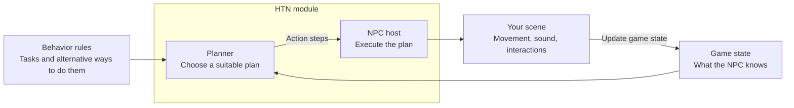
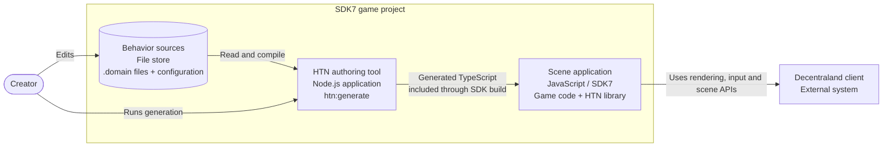

# HTN planner for Decentraland

Give NPCs tasks such as patrol, investigate a noise or chase a player, with different ways to carry them out.
Write behaviour in `.domain` files, compile it to TypeScript, and let your scene execute the plan.
This [TypeScript port of urosidoki/htn_planner](https://github.com/urosidoki/htn_planner/tree/aec08fa36f2c521c4da00c045bf23b8aed7bfa92)
includes an SDK7 NPC host. A first capsule guard needs no models or audio.

The SDK host runs NPCs on the local client. Your game owns multiplayer authority and synchronization.
The reusable module is `src/htn-planner/`; the full demonstration scene is a separate consumer.



When the world changes, the host can replan using fresh facts.

## Install with an AI agent

Give your coding agent this prompt:

```text
Add the HTN NPC module to this Decentraland SDK7 scene.

Installation and guides:
https://github.com/decentraland/sdk7-test-scenes/blob/feat/htn-planner-port/scenes/96,-11-htn-planner/README.md

1. Read the linked README and its module guide. Clarify any unspecified NPC
   behaviour and multiplayer needs with me.
2. Follow the manual copy setup, including the domain compiler, notices and
   game-owned guard files. Keep existing code, assets, settings, npm commands
   and project instructions. The automated installer is an alternative.
3. Adapt the guard or use a matching HOW-TO recipe. Keep my behaviour, actions
   and assets outside the library. After changing .domain sources or includes,
   run npm run htn:generate before previewing. Preserve the source commit and
   licences. Find examples through the module guide.
4. Run the relevant available checks and build. Report what was connected,
   checks passed, and how I can try the behaviour in Explorer. Keep client
   verification separate from headless results.
```

## Add it to your scene

### 1. Copy

Follow the [manual copy setup](src/htn-planner/README.md#install-by-copying) in an existing SDK7 scene.
It lists the library, compiler, notice command and game-owned guard files to copy, plus npm hooks and deployment exclusions.
Keep your scene's entrypoint, assets and settings. The guide also offers an optional automated installer.

### 2. Configure the behaviour

Edit your `src/npc/guard/guard.domain` and its `guard_kit.domain` include, then run:

```sh
npm run htn:generate
```

The generated TypeScript triggers SDK hot reload if Preview is open; otherwise start your normal Preview.
The game-owned `htn.config.json` lists generation targets. Commit the config, sources and generated output together.
See the [generation workflow](src/htn-planner/README.md#domain-generation-and-preview) for errors and direct Creator Hub Publish,
or the [optional watcher](src/htn-planner/README.md#optional-watch) for frequent edits.

### 3. Connect

Merge this setup into your scene's `src/index.ts`, using your existing `main()` when you have one:

```ts
import { createCapsuleBody, GuardSquad, plannerFor, v3 } from './htn-planner'
import { guardDomain } from './npc/guard/guard.htn'

export function main() {
  const guards = new GuardSquad({ planner: plannerFor(guardDomain), reasoning: 'reasoning' })
  guards.spawn([{ id: 'guard', route: [v3(4, 0, 4), v3(12, 0, 4), v3(12, 0, 12)], body: createCapsuleBody }])
}
```

The squad registers its own update system. Call `guards.despawn()` when your game removes this encounter.

### 4. Try it

Run your normal build and preview. The capsule patrols its route and chases the local player when detected.
Approach it, move away and check that the result fits your game. A successful build does not prove the encounter works in Explorer.
For loading-phase preparation and staged activation, see [Preparation → Ready → Play](src/htn-planner/HOW-TO.md#7-prepare-ai-before-play).

## Project containers (C2)



The Node.js authoring tool runs during development. Generated TypeScript reaches the scene through the SDK build,
not a network service. See [runtime components](src/htn-planner/HOW-TO.md#runtime-components-c3) for the scene's internal roles.

## Make your own behaviour

Start with the [small-domain authoring example](src/htn-planner/HOW-TO.md#6-design-and-check-a-small-domain),
then use the [integration recipes](src/htn-planner/HOW-TO.md) for your own entity, facts and actions.
[Domain design guidance](docs/htn-guidance.md) covers priorities, fact ownership, interrupted tasks and host contracts.

The planner does not simulate action effects or repair part of a plan. Your executors change the world; each replan builds
another whole plan. Read the [planning contract](src/htn-planner/README.md#choose-the-right-planning-contract) before adapting a behaviour.

## Examples and the demo

Use the [example catalogue](docs/htn-examples-catalog.md) to find a matching domain.
The [module guide](src/htn-planner/README.md#examples-for-people-and-ai) explains where to find local references and,
when absent, examples at the matching source revision on GitHub.

To explore the full scene at **96,-11**, run `npm install`, then `npm start` here.
[Ambush with Krampus starts by default](DEMO.md#the-playground); the **Playgrounds** menu offers the other lessons.
The demo, debugger UI, examples and their assets are separate consumers, not required parts of your game.

The alternative installer's `--reference` option keeps a removable source snapshot in `reference/htn/`, excluded from deployment.
Adapt only the code and assets you choose to use into your game's folders, preserving applicable notices.

## Debug and test

For a behaviour that picks the wrong plan or gets stuck, use [domain debugging](docs/htn-guidance.md#testing-and-debugging).
The [demo guide](DEMO.md) covers the in-scene debugger and repository CLI tools.
For game-owned cases, use the optional [consumer testing tools](docs/consumer-testing.md).

For source-checkout verification, run `npm run htn:ci`: notices, headless tests, types, root-domain checks, lint and
strict running-plan checks. Keep headless results separate from checking movement and feedback in a target client.
Regenerate committed modules when their `.domain` sources change.

## Reference and updates

- [Module installation, updates and source-version tracking](src/htn-planner/README.md)
- [Planner language, semantics and limitations](src/htn-planner/htn/README.md)
- [NPC host, executor lifecycle and integration options](src/htn-planner/npc/README.md)
- [Measure planning in your own domain](docs/consumer-benchmark.md)

Keep runtime code independent of demonstration levels and Node-only authoring tools.
Use the relevant tool's `--help` for its available commands and options.

## Measured planning and action work

Recorded on 2026-10-23 at source `11d2f5f617a4d127ae0bba8f42431d9c6ce5b740`, Windows x64,
Intel Core Ultra 9 275HX, Node 22.22.2. Warm p50 ranges across two reports, in **microseconds per operation**:

| Workload | Warm p50 |
| --- | ---: |
| Plan: 3 fact rows, 2 steps | 5.0–5.9 |
| Plan: 624 fact rows, 241 steps | 240.7–308.0 |
| Built-in wait: factory/start/15 updates/done | 0.68–0.71 |
| Built-in move: factory/start/109 updates/done | 18.6–19.8 |
| Tick all 32 patrol guards | 67.2–71.0 |

These elapsed Node timings describe batch means around CPU work. First calls were slower: about 1.55/7.53 ms for tiny/heavy
planning and 8.87 ms for the first 32-guard tick. They exclude rendering/ECS writes, real raycasts, physics, networking and
pathfinding; they establish no Explorer FPS or NPC capacity. Wait/move advance simulated time without sleeping.
The [full measurements](docs/performance-measurements.md) retain p95/p99, cold/warm results, method and reproduction commands.
Use `npm run htn:perf` in the source checkout, or optional `htn:measure` in an installed consumer.

## Licences

The port, host and original tooling are MIT, copyright 2026 Decentraland Foundation. Upstream MIT and other component notices remain
separate. Preserve both library licence files; see the [redistribution instructions](src/htn-planner/README.md#licences-and-deployment).
The notice command generates `htn-notices.txt` for deployment. The full demo also includes its example-specific credits there.
