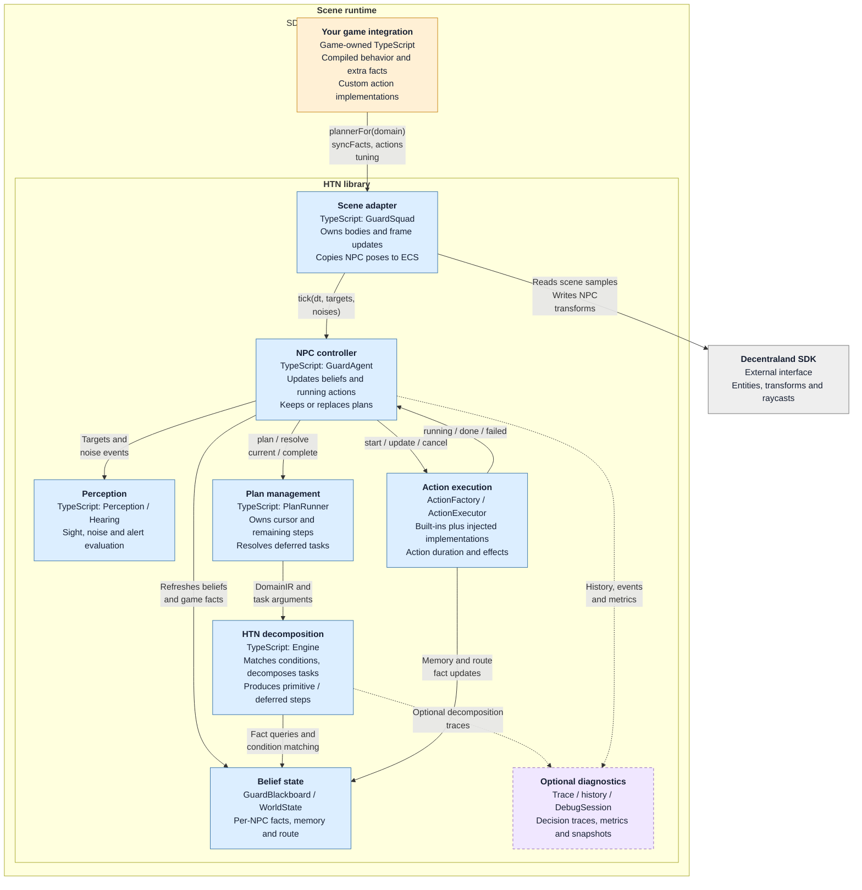

# HTN integration recipes

Paths below are relative to your scene's `src/index.ts`. First follow the [manual copy setup](README.md#install-by-copying)
for the library, compiler and game-owned guard files; automated installation with `--starter` is an alternative.
If your scene already has `main()`, merge the relevant setup into it. Your game owns the code outside `htn-planner/`.

## 1. A capsule guard

```ts
import { createCapsuleBody, GuardSquad, plannerFor, v3 } from './htn-planner'
import { guardDomain } from './npc/guard/guard.htn'

export function main() {
  const guards = new GuardSquad({ planner: plannerFor(guardDomain), reasoning: 'reasoning' })
  guards.spawn([{ id: 'guard', route: [v3(4, 0, 4), v3(12, 0, 4), v3(12, 0, 12)], body: createCapsuleBody }])
}
```

Run your preview. Expect a capsule to patrol its three waypoints, react to the local player and investigate last-seen
positions or noises. Position the route inside your scene. This is local-client NPC simulation; the module does not
synchronize NPCs across players. Call `guards.despawn()` when the encounter ends. Spawn registers one squad system;
adding another update system would tick the same NPCs twice.

After changing your game-owned `src/npc/guard/guard.domain` or its `guard_kit.domain` include, run:

```sh
npm run htn:generate
```

Try the result in your normal Preview; an open SDK preview reloads the generated TypeScript.
Edit `.domain` sources, not generated `.htn.ts` files. See [generation and Creator Hub](README.md#domain-generation-and-preview)
for error handling and Publish checks, or use the [optional watcher](README.md#optional-watch) for frequent edits.

## 2. Drive an existing entity

Keep your model and audio in your own assets folder. Instead of `createCapsuleBody`, use `possessEntityBody`:

```ts
import { Entity } from '@dcl/sdk/ecs'
import { GuardSquad, plannerFor, possessEntityBody, v3 } from './htn-planner'
import { guardDomain } from './npc/guard/guard.htn'

export function startGuard(entity: Entity) {
  const guards = new GuardSquad({ planner: plannerFor(guardDomain), reasoning: 'reasoning' })
  guards.spawn([{ id: 'guard', route: [v3(4, 0, 4), v3(12, 0, 12)], body: () => possessEntityBody(entity, { groundY: 0 }) }])
  return guards
}
```

Call `startGuard` once the entity has a Transform. Choose `groundY` for its feet and `facingYaw` if the model faces away
from +Z. Despawn restores the entity's original pose. Animation and sound remain your host's responsibility; look for
`src/examples/stalker/` locally in `reference/htn/`, then in the source URL from `SOURCE.json` if absent.

## 3. Add your own facts and actions

Use `syncFacts` and `actions` instead of editing library source. This setup supports a domain that reads
`(door_open 1)` and emits `(!ring_bell)`:

```ts
import { bool, createCapsuleBody, GuardSquad, instant, plannerFor, v3 } from './htn-planner'
import { guardDomain } from './npc/guard/guard.htn'

export function main() {
  let doorOpen = false // Change this from your game's door events.
  const guards = new GuardSquad({
    planner: plannerFor(guardDomain),
    reasoning: 'reasoning',
    syncFacts(agent) {
      agent.blackboard.world.set('door_open', bool(doorOpen))
      return String(doorOpen) // A changed key requests a replan.
    },
    actions: {
      '!ring_bell': () => instant(() => {
        console.log('Bell rang') // Replace with your game effect.
        return 'done'
      })
    }
  })
  guards.spawn([{ id: 'guard', route: [v3(4, 0, 4), v3(12, 0, 12)], body: createCapsuleBody }])
}
```

A host BOOL fact matches the integer `1` for true or `0` for false; `true`/`false` in a domain are symbols.
The starter domain does not yet use that fact/action: add the relevant condition and task to your game-owned domain,
then compile it. Built-in guard actions remain available; a custom factory with the same name replaces that action.
Factories create an executor per step (`start`, `update`, `cancel`); return `failed` when an action cannot finish.
Write a real effect only when it occurs. For a game event that needs a decision without changing a fact key, call
`handle.agent.requestReplan('door changed')` on the relevant guard handle from `guards.guards`.

For a host with its own movement/execution loop, use `GuardAgent` directly, or set `GuardSquad`'s `system: false` and call
`guards.update(dt)` from your own loop. See the [NPC reference](npc/README.md) for advanced contracts.

## 4. Inspect a decision, optionally

```ts
import { agentHistory, GuardSquad, PlanTraceRecorder, plannerFor } from './htn-planner'
import { guardDomain } from './npc/guard/guard.htn'

const trace = new PlanTraceRecorder(guardDomain)
const guards = new GuardSquad({
  planner: plannerFor(guardDomain, { trace }),
  reasoning: 'reasoning',
  history: () => agentHistory(128)
})
```

Add your normal spawn. Read `trace.runs` and agent history when investigating a decision. For several guards, give each
its own recorder with the `(world, spec)` planner factory. Trace/history record extra data and allocate; leave their
options unset in normal play. This does not install debugger UI or any gallery assets.

The full scene's `src/debugger/` and repository tools `htn:run`, `htn:view`, `htn:level`, `htn:golden` are optional demo/toolkit
consumers, not a portable dependency of the library/compiler install. In particular, `htn:run` uses built-in example
catalogues and the demo's runner. Run those tools in the source checkout; copying their launchers alone is insufficient.
Inspect their sources through the local-reference/GitHub route in the [module guide](README.md#examples-for-people-and-ai).

## 5. Use the planner without SDK entities

Import `PlanRunner` from `./htn-planner/htn/planner` and `WorldState` from `./htn-planner/htn/world-state` when you only need
planning. These modules are SDK-independent; the top-level barrel also exposes SDK adapters. You provide facts,
callterms and action execution. Follow the [planner interface and semantics](htn/README.md); the planner does not
simulate primitive effects or repair part of a plan.
## 6. Design and check a small domain

First write the decision in words: **alarm before work; completed work ends; resume your own claim; acquire only a free
resource; otherwise wait**. Record who writes the facts and when: the sensor owns `alarm/0`; successful `!claim` writes
`owner/1`; successful `!finish` removes that claim and writes `done/1`. Cancellation releases this actor's reservation,
while completed physical effects remain true. Test cleanup in the executor/host as well as in the domain.

Save this small planning example as `src/npc/job.domain` (the shared-job pattern from the source consumer fixtures):

```lisp
(:domain Job top_level_domain
  (:method (job ?inp_who) top_level_method
    (danger (and (alarm)) ((!flee ?inp_who)))
    (done (and (done ?inp_who)) ())
    (resume (and (owner ?inp_who)) ((!finish ?inp_who)))
    (acquire (and (not (owner ?any_owner)))
      ((!claim ?inp_who) (!finish ?inp_who)))
    (wait () ((!wait ?inp_who)))
  )
)
```

The root already explains its priorities; extra wrapper tasks would add little. Extract a parameterised task or axiom
when several behaviours share a sequence or condition. Put general belief expiry in the host or a wired `reasoning`
method, so it does not compete with a job for priority. There is no minimum branch count or required depth.

Before running `job a`, derive these complete expectations from the strategy:

| Relevant world | Expected status and plan | Reason |
| --- | --- | --- |
| No owner, no alarm, not done | `succeeded`: `!claim a`, `!finish a` | Acquire free work. |
| `owner b` | `succeeded`: `!wait a` | Another actor owns it. |
| `owner a` | `succeeded`: `!finish a` | Re-enter after the claim without claiming twice. |
| `done a` | `succeeded`: empty | Deliberate completion; the host stops or waits for another event. |
| `alarm`, even with `owner a` | `succeeded`: `!flee a` | Interrupt first; the host releases this actor's claim. |

```sh
npm run htn:compile -- --check src/npc/job.domain
npm run htn:compile -- src/npc/job.domain src/npc/job.htn.ts jobDomain
```

Compilation validates syntax, not execution. Implement and register every primitive before using the domain with an
NPC; `!wait` must let time pass. A later condition cannot see the effect of a planned `!claim`: put that decision in
`&task` or in the next plan after the executor writes it. A deferred loop still needs progress and a stop bound.

For reproducible checks, install `--testing` from the same module source and follow its `docs/consumer-testing.md` to
encode the table in a game-owned manifest. Add an invariant that rejects two different `owner` rows. A shared-host
story should interrupt after claiming, fail once, then verify another actor can work and no stale claim remains.
Do not fill expectations from actual planner output. Run a near-miss that changes the chosen branch, and deliberately
break one expectation to check that your test command fails.

The source fixture `test/fixtures/consumer/jobs.tests.ts` executes this resource/cleanup pattern with explicit bindings;
find it through the [local-reference and pinned source route](README.md#examples-for-people-and-ai). The source guidance
also walks through `soup_kitchen`, an executable team plan with handoffs and deferred cooking. Those paper hosts model
fact writes and recovery; verify actual movement, cancellation and shared authority in your own target-client host.

## 7. Prepare AI before play

Use a host-owned **Preparation → Ready → Play** state when an encounter has noticeable startup work. This can move
some work before gameplay; it cannot guarantee a spike-free first tick. The recorded Node first-tick measurement
starts after imports and constructors, and still includes sensing, initial planning, reasoning and action execution.
First-use allocation and JIT optimisation are possible contributors, not separately measured causes. This is not a
cost paid by every spawn, nor a guarantee that it happens only once.

### Preparation

Compile domains to TypeScript during authoring/build, as above. Behind your loading state, process a small preparation
job or activation batch in each actual SDK update, then return and wait for the next engine frame. Keep gameplay
inactive until those jobs finish. Showing an overlay or awaiting `Promise.resolve()` alone does not yield CPU time to
the next frame; a long synchronous plan still blocks that update.

Optionally exercise a few representative **plan-only** cases in the target runtime: use `PlanRunner.plan()` with an
independent world and pure or sandboxed bindings. Do not tick live agents, resolve deferred work or start executors
as a warm-up shortcut. Planning can invoke callterms, converters, member daemons and context/diagnostic/trace hooks;
these must not mutate live state, advance simulation time or consume gameplay RNG. `snapshotWorld()` copies table arrays, not nested
values: sharing rows/Atoms is safe only while respecting their immutability contract. A separate world is insufficient
if bindings/context still refer to live state; keep mutable values and callback closures independent too. Skip this optional step when effects cannot be isolated or one case is too costly.

### Ready

Discard preparation plans and restore any preparation state before activation. `PlanRunner.clear()` only clears its
plan cursor/count: it does not undo world/context writes, cancel executors or release buffers. Reusing the same runner
with its correctly owned world retains its search storage; its world cannot be rebound. A disposable runner offers only
possible process-level/JIT benefit, with no buffer transfer to the separate runners a `GuardAgent` creates. There is no
warm-up API or fixed run count that covers all future branches.

### Play

Spread real NPC construction/spawn and activation over frames too. Start their real plans from fresh sensor facts;
never copy a preparation plan into live execution. A custom host can share one `PlanBudget` instance through each
agent's `GuardAgentOptions.planBudget`, calling `beginFrame()` once per actual frame before ticking those agents.
For a `GuardSquad`, provide `budget` options: the squad creates its own budget and resets it inside `update()`.
Sharing one budget instance across independent squads is not supported. Do not reset a custom host's budget per NPC.

`maxPlansPerFrame` limits whole replan callbacks, including their planning passes/upkeep. `planBudgetMs` is a soft
check before a callback, not preemption; even zero milliseconds does not pause all planning. Sensing, active-plan
checks, ongoing action execution, construction and asset loading are outside that limit. Choose small batches from target-client
measurements. Node warm-up does not warm an Explorer process; new paths, deoptimisation, reloads and new runners may
still incur first-use costs. Measure model, animation and audio preparation separately from planning.

## Runtime components (C3)



Gold is game-owned code, blue is library runtime and extension contracts, grey is the SDK, and purple/dashed is optional diagnostics.
Arrows name in-process operations, inputs or returned status; dashed lines mean optional, not network or asynchronous work.
This is a static view, not the sequence of each update. The
[project containers](https://github.com/decentraland/sdk7-test-scenes/blob/main/scenes/96,-11-htn-planner/README.md#project-containers-c2)
show authoring and SDK build outside this runtime.
